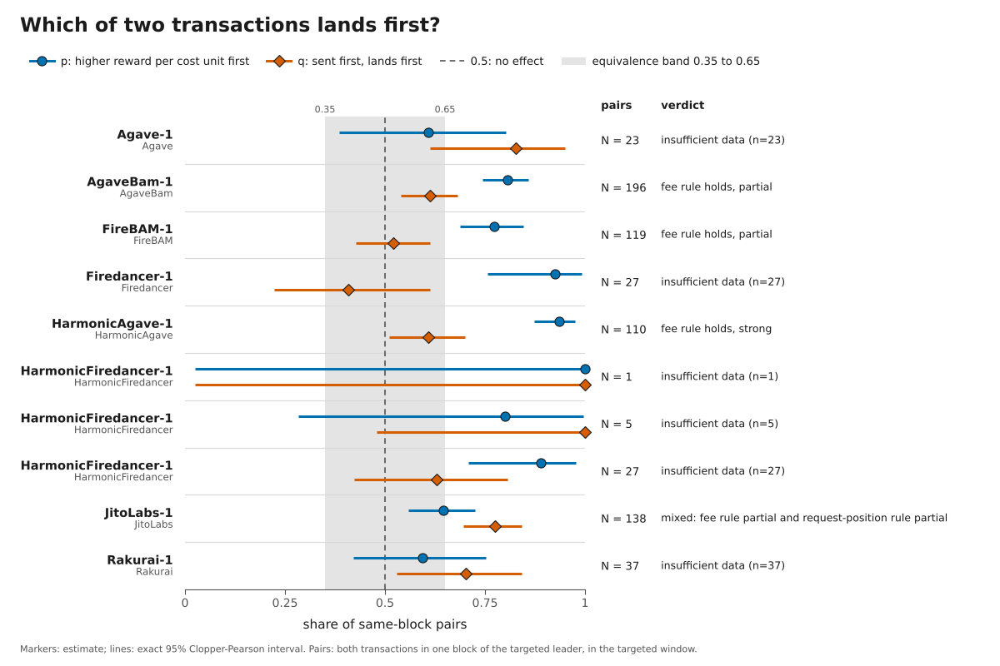

# Inside the Block: how Solana mainnet leaders order transactions

Interactive summary: https://recruitabx.github.io/Inside-The-Solana-Block/

**Question.** For each of eight mainnet validators running different client software (Agave, Jito, BAM, Harmonic, Firedancer, Rakurai), what decides which of two transactions lands earlier in the leader's block, how strictly, and is there a rule at all?

**Method in one paragraph.** We send pairs of our own transactions into each target's leader window. The two transactions of a pair differ only in fee (3.2x reward per cost unit), both write one shared account so the scheduler must serialize them, and which one is high-fee and which one goes first in the request are randomized independently. From each block (`getBlock`) we read which came first, giving two numbers per validator: p (share of pairs where the higher-fee transaction came first) and q (share where the first-sent came first), with exact confidence intervals and verdicts fixed in advance in [docs/PREREGISTRATION.md](docs/PREREGISTRATION.md). All measurements are after the Alpenglow upgrade (slot 459653008 and later, [docs/ALPENGLOW_BOUNDARY.md](docs/ALPENGLOW_BOUNDARY.md)).

**Result.** For every validator with at least 10 usable pairs, the higher-fee transaction of a conflicting pair came first in more than half of them (p from 0.59 to 0.94), but never strictly. 4 validators reached the preregistered N of 100 and got a verdict at family alpha 0.025: AgaveBam-1 (AgaveBam) fee rule holds, partial; JitoLabs-1 (JitoLabs) mixed: fee rule partial and request-position rule partial; FireBAM-1 (FireBAM) fee rule holds, partial; HarmonicAgave-1 (HarmonicAgave) fee rule holds, strong. In pairs that were sent before the leader's window and landed in its first slot, the higher fee came first in 0.85 [0.77, 0.91] (n = 124); when the two were sent 200 ms apart, the first-sent came first in 13 of 13. The main limitation: we could only send through one RPC provider (no direct QUIC), so true arrival order at the leader is not observed, and the Firedancer and HarmonicFiredancer leaders, as well as the two low-stake ones, rarely included our pairs in their own window.

| Validator (role, identity) | Client, version (gossip claims) | N usable | p: higher fee first [95% CI] | q: first in request first [95% CI] | Preregistered verdict (family alpha 0.025) |
|---|---|---|---|---|---|
| AgaveBam-1 `DRpbCB..` | AgaveBam 4.4.0-rc.1 | 196 | 0.81 [0.74, 0.86] | 0.61 [0.54, 0.68] | fee rule holds, partial |
| JitoLabs-1 `E1r4Ps..` | JitoLabs 4.4.0 | 138 | 0.64 [0.56, 0.72] | 0.78 [0.70, 0.84] | mixed: fee rule partial and request-position rule partial |
| FireBAM-1 `9jxgos..` | FireBAM 26.10.5 | 119 | 0.77 [0.69, 0.84] | 0.52 [0.43, 0.61] | fee rule holds, partial |
| HarmonicAgave-1 `Fd7btg..` | HarmonicAgave 4.4.0 | 110 | 0.94 [0.87, 0.97] | 0.61 [0.51, 0.70] | fee rule holds, strong |
| Rakurai-1 `ana2y2..` | Rakurai 4.3.2, 4.4.0 | 37 | 0.59 [0.42, 0.75] | 0.70 [0.53, 0.84] | insufficient data (n=37) |
| Firedancer-1 `9eGrDo..` | Firedancer 26.10.5 | 27 | 0.93 [0.76, 0.99] | 0.41 [0.22, 0.61] | insufficient data (n=27) |
| HarmonicFiredancer-1 `JUPiTE..` | HarmonicFiredancer 26.10.5 | 27 | 0.89 [0.71, 0.98] | 0.63 [0.42, 0.81] | insufficient data (n=27) |
| Agave-1 `7QQGNm..` | Agave 4.3.2, 4.4.0 | 23 | 0.61 [0.39, 0.80] | 0.83 [0.61, 0.95] | insufficient data (n=23) |
| HarmonicFiredancer-1 `Awes4T..` | HarmonicFiredancer 26.10.5 | 5 | 0.80 [0.28, 0.99] | 1.00 [0.48, 1.00] | insufficient data (n=5) |
| HarmonicFiredancer-1 `87CcUx..` | HarmonicFiredancer 26.10.5 | 1 | 1.00 [0.03, 1.00] | 1.00 [0.03, 1.00] | insufficient data (n=1) |

Source: `results/verdicts.csv` (built by `docker compose run --rm analyze` from `data/raw/`; full identities, Holm-adjusted p-values and the 2 x 2 tables are there). Measurements: 2026-10-31 08:38 to 22:31 UTC and 2026-11-04 08:34 to 19:56 UTC (extension, Amendment 7), all after the Alpenglow upgrade; per-run dates in [results/runs.md](results/runs.md); full write-up in [REPORT.md](REPORT.md).



## Design at a glance

| | |
|---|---|
| Unit | a pair of our transactions aimed at one leader window |
| Primary arm (70%) | conflicting pair (shared writable account), high vs low fee, one JSON-RPC request, positions randomized |
| Controls | equal-fee pair (noise floor), disjoint pair (execution race), two requests 200 ms apart in random order (arrival rule) |
| Targets | one validator per client type, chosen by a stated rule from the leader schedule and stable gossip claims (`data/validators.json`) |
| Outcome | which transaction has the lower index in `getBlock`, block producer from the block's `Fee` reward |
| Verdicts | fee rule (strict, strong, partial), request-position rule, mixed, no rule detected (equivalence test), insufficient data |
| Spend | hard cap of 0.05 SOL in code (`src/itb/spend.py`), planned fees at most 0.0434 SOL |

Why this design: [docs/DESIGN.md](docs/DESIGN.md). Source-code research behind it, with pinned commits: [docs/research/](docs/research/). Known-answer calibration on a local Agave validator: [docs/CALIBRATION.md](docs/CALIBRATION.md).

## How the design handles each consideration

| Consideration | How it is handled, or why deliberately not |
|---|---|
| Leader schedule and leader types | Windows are 4 slots. Targets are frozen identities, one per client type, chosen by a stated rule that requires a stable gossip clientId over at least 18 hours, because claims flap (33 of about 3,900 nodes changed claim within 80 minutes on 2026-10-30). The clientId and version are snapshotted at the start and end of every run. The block producer is read from the block, never assumed from the schedule. |
| Path from our backend to the executing node | Our sending machine cannot use UDP or QUIC, so every transaction goes as an HTTPS JSON-RPC request to one RPC provider, which forwards it to the current and next leaders. We disable retries, log send times and offsets, and list what we cannot see (provider internals, a possible fee-dependent fast lane, external builders) as not separated. |
| Interaction of our own transactions with each other | Within a pair the interaction is the design (shared writable account forces serialization; one arm without it). Across pairs there is none: one probe per window, a fresh shared account per probe, distinct payers, at least 2 s between probes. |
| Competition inside the block | Other transactions compete with ours; ours pay well above typical priority, so both can be scheduled promptly and their relative order is the leader's decision. Block size, total CU and slot index are recorded, and other people's transactions in the same blocks are used as secondary evidence. |
| Send order | The request position of the high-fee transaction is randomized independently of the fee, giving q; a separate arm sends the two transactions 200 ms apart in random order. |
| Noise versus rule | Estimands, thresholds and an equivalence margin for "no rule" are fixed before the data; an equal-fee control gives the noise floor; Holm correction over all tests; the analysis code recovers planted rules on synthetic data and known answers on a local validator. |

## What we do NOT separate

- First in, first out by true arrival at the leader from random order within one request (arrival times at the leader are not observable).
- Fee-dependent routing by the RPC provider from a fee rule at the leader.
- External builders (BAM node, Harmonic builder) from the validator's own scheduler.
- Operator configuration from client software (a verdict describes one validator).
- Whether both transactions were in the scheduler buffer at the same time (p is a lower bound on a priority rule's strictness).
- Self-reported leader software (gossip claims can flap between machines).

Details: section 13 of [docs/PREREGISTRATION.md](docs/PREREGISTRATION.md).

## Reproduce

```bash
cp .env.example .env              # set RPC_URL; nothing is sent without the steps below
docker compose run --rm test      # unit tests (spend cap, dry-run, analysis on synthetic data)
docker compose run --rm dryrun    # real leader schedule, transactions built and signed, nothing sent
docker compose run --rm verify    # re-check our transactions against mainnet blocks
docker compose run --rm analyze   # all tables and verdicts from data/raw
docker compose run --rm audit     # every fee-paying transaction of our accounts is in the spend ledger
```

Live sending needs all of: the `live` service, `ITB_LIVE=1`, a wallet file mounted read-only (`ITB_WALLET_FILE`), and room under `ITB_SPEND_CAP_LAMPORTS` (at most 50,000,000). Every transaction's worst-case fee is written to `data/ledger/spend.jsonl` before it is sent.

## Rubric map

| Judging criterion (weight) | Where it is addressed |
|---|---|
| Design validity (35%) | [docs/DESIGN.md](docs/DESIGN.md), the Considerations table above, [docs/PREREGISTRATION.md](docs/PREREGISTRATION.md) with its amendments, [docs/CALIBRATION.md](docs/CALIBRATION.md), [docs/research/](docs/research/) |
| Verifiability and reproducibility (25%) | `docker compose run --rm verify` (public RPC, no key), raw data in `data/` ([DATA.md](DATA.md)), three mainnet anchors, `docker compose run --rm analyze` |
| Analysis quality (25%) | [REPORT.md](REPORT.md): exact intervals, preregistered verdicts, equal-fee control, co-presence subgroup, arrival arm, what went wrong |
| Engineering (15%) | dry-run default, spend ledger and single send function (`src/itb/spend.py`, `src/itb/send.py`), `itb audit`, tests (`docker compose run --rm test`), Docker Compose services |

## Repository map

| Path | Content |
|---|---|
| `src/itb/` | runner (dry-run default), spend ledger and single send function, collector, analysis, verify, audit |
| `data/` | raw send logs, landing records, gossip snapshots, spend ledger, calibration ([DATA.md](DATA.md)) |
| `docs/` | preregistration, design rationale, calibration, Alpenglow boundary, source research |
| `scripts/` | target freeze, plan, localnet calibration, acceptance checks, pre-publication check |
